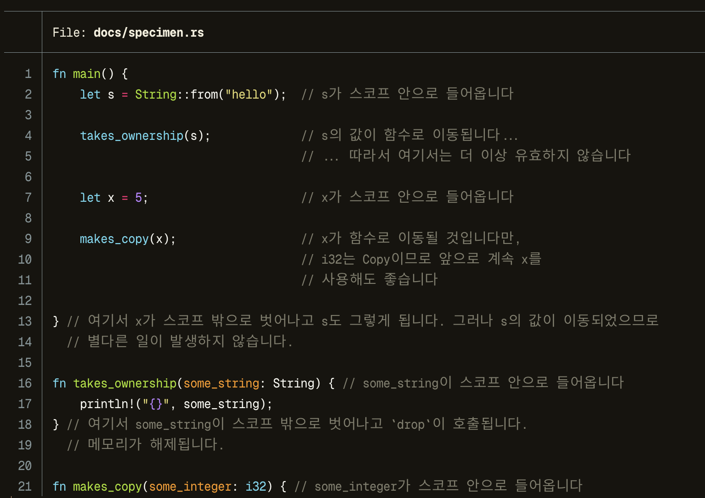

# Kondensation Mono

A terminal font that makes Hangul read as naturally as possible while keeping Latin text fully legible.

영문 가독성을 해치지 않는 선에서 한글이 최대한 자연스럽게 읽히도록 만든 터미널 폰트입니다.



<sub>Code: Listing 4-3 from the [Korean translation](https://doc.rust-kr.org/ch04-01-what-is-ownership.html) of The Rust Programming Language.</sub>

Inspired by [Yeomil Mono](https://github.com/taevel02/yeomil-mono) and [Jetendard](https://github.com/kuskhan/jetendard).

## Install

Download `KondensationMono-<version>.zip` from [Releases](../../releases/latest) and unzip it.

```sh
# macOS
cp KondensationMono-*/*.ttf ~/Library/Fonts/

# Linux
mkdir -p ~/.local/share/fonts
cp KondensationMono-*/*.ttf ~/.local/share/fonts/ && fc-cache -f
```

## Changelog

- v1.0.0: Initial release

## License

Kondensation Mono is released under the [SIL Open Font License 1.1 (OFL-1.1)](LICENSE). It is built from these fonts:

- [Geist Mono](https://github.com/vercel/geist-font) by Vercel, OFL-1.1. All Latin glyphs. They are condensed from a 0.6em to a 0.55em cell and instanced about 9% heavier, so vertical stems keep the weight of each style.
- [Pretendard](https://github.com/orioncactus/pretendard) by Kil Hyung-jin, OFL-1.1. Hangul and CJK punctuation. They are enlarged 1.15x, as in Jetendard, and centred in two-cell (1.1em) boxes, so syllables sit closer together than in most monospace Korean fonts.
- [Nerd Fonts](https://github.com/ryanoasis/nerd-fonts) by Ryan L McIntyre, MIT. Icons from Symbols Nerd Font Mono, scaled to one cell, with Powerline separators stretched to the full line height. The MIT license text ships in the release zip as `LICENSE-NerdFonts.txt`, and each icon set keeps its own license.
